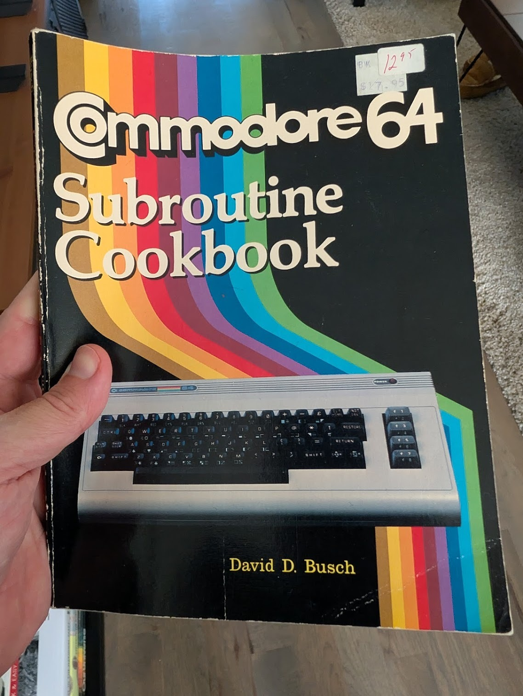

Coding agents are everywhere.
Not a day goes by that I don't talk with a customer, someone in the community, or a random stranger on the street, about using AI to write software.
I'm doing it.
I would say 99% of all the code that I've "written" in the last 6 months has been done by an agent.
And the vast majority of the code I write are Temporal Applications.
Between demos, customer POCs, side projects, and my work with the [PyTexas Foundation](https://pytexas.org), I average three to five net-new Temporal apps a week, using just about every feature Temporal has to offer.
These aren't all toy projects, either.
Sure, some are (looking at you, [Durable Wordle](https://github.com/temporal-community/durable-wordle)), but plenty of them run in production, powering real parts of my life and my community.

So when someone gets on a call and tells me their agent can't write correct Temporal code, I'm usually surprised.
After digging in to their agentic coding workflow I can usually spot the issue almost immediately.
And almost always, they aren't taking advantage of the tools and resources that enable their agent to be successful writing Temporal code.

So, let's setup your workspace so you don't have to fight with your fancy (and expensive) robots about how to properly unit test a Signal.


This is how I ship production-ready Temporal applications with an agent, week after week.
I use Claude Code, but the vast majority of my advice is not harness specific, and when they are I'll explain the concept rather than the exact tooling as well.
The same ideas apply to whatever agent you prefer.
It also doesn't much matter what kind of project you're working on, whether it's a fully spec'd greenfield build, a modernization effort introducing Temporal, or a one-line bug fix in an existing Workflow.

Using agents to build Temporal applications (or in fact, _any_ software project) comes down to three things: 
- Give the agent the right context to build with
- Keep it honest with guardrails
- Ensuring both you and the agent are on the same page about what to build

Let's start with context.

## Making Agents Good at Temporal

I've been at Temporal long enough to remember when agents were genuinely awful at writing it.
In early 2023 there wasn't enough Temporal content on the internet to train a model into being useful, so you'd get code that was confident, plausible, and completely wrong.
That has changed, partly because there's more material out there now, but mostly because we've built resources designed specifically to feed an agent the right patterns.
This is the three tiered approach I use to provide my agents the context it needs.
Let's start with the quickest win.

### The Temporal Developer Skills

Start with the [Temporal Developer Skill](https://docs.temporal.io/with-ai#temporal-developer-skill).
This is the foundation of building any Temporal application with agents.


A Skill is a curated bundle of instructions and references that the  decides whether to load based on its task.
This one is maintained by our own engineers and checked for correctness, so the patterns it hands the agent are the ones we'd actually endorse.
We've built out the skill to work with various agentic coding tools ([`Claude Code`](https://docs.temporal.io/with-ai?skill-install=claude-code#temporal-developer-skill), [`Cursor`](https://docs.temporal.io/with-ai?skill-install=cursor#temporal-developer-skill), [`Codex`](https://docs.temporal.io/with-ai?skill-install=codex#temporal-developer-skill), and integration with [`npx skills`](https://docs.temporal.io/with-ai?skill-install=npx#temporal-developer-skill)).
Not using any of those?
No problem, there's [manual](https://docs.temporal.io/with-ai?skill-install=manual#temporal-developer-skill) instructions too.
We also have a [Temporal Cloud Skill](https://docs.temporal.io/with-ai?skill-install=npx#temporal-cloud-skill) that enables your agent to troubleshoot Temporal Cloud issues. 

One caveat I want to add here, and this goes for _all_ skills, not just the Temporal one.
I **always** manually invoke my skills at the beginning of a session. 
Why take the gamble that the classifier didn't work that time and waste time and tokens?
I'd rather spend the extra thirty seconds it takes to type `/temporal-developer` than fire off a task only to find out later it didn't invoke and now I have to either run a cleanup pass or back everything out and try again. 

You should use these.
Every _single_ time.
We've had multiple customers tell us that they reduced their development time by 50% with a 70% reduction in failures in existing code.
Use it for building new as well as reviewing existing code.
You'll be surprised on what it will find.

### SDK Samples Repositories

The Skill is the first component, but for even more flavor you should add the Temporal SDK Samples Repositories as context for your agent.


Every official Temporal SDK has an official samples repository for that particular programming language, and they even have a standardized naming scheme.
Each one is a collection of working implementations covering Temporal's features, written by the SDK teams, with explanations of when to use each pattern.
For Python it's [`samples-python`](https://github.com/temporalio/samples-python), for Go [`samples-go`](https://github.com/temporalio/samples-go), for TypeScript [`samples-typescript`](https://github.com/temporalio/samples-typescript) and so on.

Think of these repositories as recipes.
The idea of a "programming cookbook" has been around for a long time.
I remember finding the answer to a particular tricky decorator question in the Python Cookbook very early in my career, but the idea of a "programming cookbook" has been around for a long time.



So I recommend adding them to your agent's workspace and telling it to reference them.
For Claude Code, I bring them into the session with `/add-dir`.
Before `/add-dir` was a command in Claude Code I used to just clone the repository into my workspace and tell my agent about it. 
And that is a **crucial** part. 
Don't just add it and hope the LLM finds it.
Tell it explicitly:

```
In the samples-python directory exists curated snippets of Temporal code highlighting best patterns and features written by Temporal experts. Reference these when planning or implementing any Temporal application code. 
```

Now you may ask, "Why use both, when the skill already exists?"
And that's a valid question. 

First, it's important to understand what the skill is and does. 
The Skill aims to be a condensed version of Temporal knowledge, containing information about features and best practices.
But the samples repo is like the cookbook recipe, it's very specific instructions for very specific use cases. 
The code within the repo is also fully executable, verified, and tested.

So they complement each other, they don't compete.
Even if there is duplicate information between them, that just reinforces the concept within the model that what it inferred from them is the correct pattern.
The more high-quality, curated context you give the agent, the better the output, and the samples are some of the highest-quality context we have.

### Temporal Knowledge Base MCP

So now you have all the ingredients and the recipes, but that doesn't immediately make you a good cook.
Sometimes you need an expert. 


This resource provides exactly that, and it's the [Temporal Knowledge Base MCP server](https://docs.temporal.io/with-ai#temporal-knowledge-base--mcp-server).
You may have used it before, as it's what powers the **Ask AI** button at the top right hand corner of the Temporal Docs, or the [`#ask-ai`](https://temporalio.slack.com/archives/C05JRT1GKEE) channel in our [Community Slack](https://t.mp/slack).
I know, most engineers reflexively ignore those buttons because they're usually useless.
But I promise you, this one isn't.

Behind it is the most complete knowledge base of Temporal that I've seen.
It's immensely better at giving deep Temporal answers than event the best foundational models.
It's a RAG over everything we know about the product: the docs, the courses, the community forums, and curated answers from our engineers and support teams in the community Slack.
It's the canonical source, and most importantly _it cites itself_, so every answer comes back with a reference you can follow and verify.
When it doesn't know it will say that it can't find information about that topic in the knowledge base.  
This provides amazing support for your LLM, because it not only reports the answer back, but links to documentation the LLM can then read if it chooses.
So connect it as an MCP server and your agent can query it directly.
I used to not do this, and only use the first two suggestions.
I noticed a _substantial_ increase in the quality of the architectural decisions that my agents were coming to.

I recommend leaning on this hardest during design.
When the agent is unsure about a pattern, or makes an assumption I can't confirm, I tell it to validate against the knowledge base before it writes a line.
Preventing improper architecture from the start is way easier than trying to refactor it later.
That one habit prevents a whole class of subtle mistakes that would otherwise surface much later, when they're far more expensive to fix.

These three elements, the Skill, Samples, and MCP, should make up the foundation of any agent that writes Temporal application code.
This will provide it will all the context it could ever eat.
But context is only part of the story.

## Making Sure Sh*t Doesn't Go Off the Rails

Context provides your agent the information it needs to make an informed decision.
However, it does not provide your agent boundaries.
Sure, you can have a Skill that contains information about how to test

Context points the agent in the right direction.
Guardrails keep it there.
Think of them like the bumpers in a bowling lane: they don't guarantee a strike, but they keep you out of the gutter.
Agents love structure, and every tool you give one to check its own work lowers the odds it quietly drifts off course.
For Temporal applications, I rely on three: tests, static analysis, and the Temporal CLI.

### Testing

Testing comes first, and I mean that literally.
I have the agent practice test-driven development: write the tests, then write the implementation, then iterate until everything passes.
Writing the tests first forces the agent to reason about failure cases and edge conditions before it locks into an approach, and it gives you an immediate signal the moment a change breaks something.

Temporal makes this especially effective, because the SDKs ship with testing frameworks built for exactly this ([LINK: Temporal testing docs]).
The test environment supports automatic time-skipping, so a Workflow that sleeps for thirty days can be tested in milliseconds instead of waiting a month.
You can mock Activities to exercise your Workflow logic in isolation.
And you can write replay tests that take real event histories and run them against your current Workflow code to catch non-determinism before it ever reaches production.

That last one matters more than anything else for Temporal.
Non-determinism is the most common way agent-written Workflow code goes wrong: reaching for the system clock, generating a random value, or iterating a map directly inside the Workflow.
Replay tests are the guardrail that catches it.
So I have the agent write them, and passing them is a condition of every commit.

### Linting, Type Checking, and Whatever Else

After tests come the rest of the static guardrails.
Linters, formatters, and type checkers are cheap to run and catch a surprising amount before the code ever executes.
If you're in a language with type hints, like Python, use a static type checker, because it catches the moment the agent decides a function that should take a string now takes something else entirely.
None of my code clears the bar for a commit unless it passes linting and type checks.

The broader point: whatever quality tooling your language and project already have, wire it into the loop and make the agent run it on every pass.
It costs you a few seconds and saves you far more.

### Agents Are Good at Using the Temporal CLI

Here's the guardrail people tend to overlook: the agent can run your application and watch what actually happens.
The Temporal CLI is excellent for this, and agents are remarkably good at driving it.

Give your agent shell access and it can spin up a local server with `temporal server start-dev`, kick off the Workflow it just wrote with `temporal workflow start`, and then inspect the result instead of assuming success.
`temporal workflow list` and `temporal workflow describe` show it what's running and how things ended.
`temporal workflow show` pulls the full event history, which is where the agent can confirm the Workflow did what was intended: the right Activities ran, the timers fired, the signals landed.
It can even signal or query a running Workflow to test interactive behavior.

This closes the loop.
Instead of trusting that code which compiles also behaves, the agent executes against a real server and verifies against the event history.
When it finds a discrepancy, it fixes it and runs again.
That feedback cycle is exactly the kind of grunt work agents handle well, and it catches the bugs that slip past unit tests.

## Measure Twice, Cut Once

All of this assumes you've pointed the agent at the right problem in the first place, which is a discipline of its own.
You can't open an empty repository, type "build me a payment system," walk away, and expect something you'd put in production.
It's the same as walking into a room of engineers, saying "build it," and leaving.
It was never the implementation that was the hard part.
It's the design: the architecture, the boundaries, the decisions about what the thing actually needs to do.
That's the part worth your time.

So plan before you build, and scale the planning to the task.
A bug fix needs a sentence.
A greenfield service needs a real specification that you've read and revised.
I won't rehash my entire planning process here, but I'll push one habit: review the plan before you let the agent execute it.
I have the agent produce a spec, then I read it closely and send back corrections before a single line of code is written, because a mistake caught in the plan is free and the same mistake caught in production is anything but.

This is also why I care so much about being able to maintain whatever comes out the other end.
If all of this AI tooling went away tomorrow, and we're already getting a preview of that with the Fable model, someone still has to run the software.
Using an agent to build something isn't about getting a result.
It's about getting a result you understand and can maintain long after the agent is gone.

## Bringing It All Together

There's no secret here, and no magic incantation that makes an agent good at Temporal.
Even if there were one, knowing the incantation wouldn't be enough.
You'd still have to understand why it works.
What actually moves the needle is ordinary good engineering, paired with giving the agent the context it needs to do the job.

It's the same thing that makes a team of people productive.
A good engineering org has a clear process, solid onboarding, a real knowledge base, and references its people can trust.
An agent needs the exact same things.
The skill, the samples, and the knowledge base are its onboarding.
The tests, the type checks, and the CLI are its review process.
The planning is its design doc.
None of this is new.
We've just got a new kind of engineer to bring up to speed.

Do that, pair it with your own standards and preferences, and you'll get Temporal code that works the way you want, looks like something you would have written, and that you can actually maintain.
That, in the end, is the whole point.

<!-- TODO: CTA here -->
