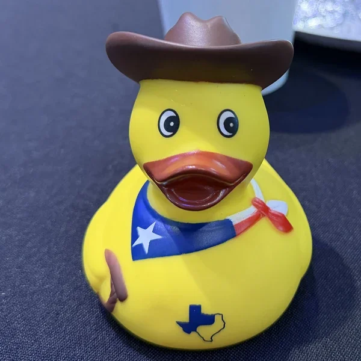

<CLAUDE_HELP priority="high" topic="title and the promise the opener makes">
You said you may retitle to the playlist name. The slug is pinned, so the URL survives a retitle; the description line would need to change with it.
Your title formula is [hook]: [dead-straight subtitle] or a two-beat punch. The dawn phrase is the hook; the subtitle slot is open and should say plainly what the post is (the answer to "why don't you leave").
The opener currently promises vindication ("proved a point", "was the reason"). If the post lands on hope, decide whether the opener promises the dawn instead, or stays as is and lets the ending turn it.
You told me to leave the opener alone earlier; this is flagged only because the frame moved under it. Your law: write the actual opening last.
If the title becomes the dawn, decide what happens to "this is why" at the very end: it stays as the button, or the dawn takes over the callback.
</CLAUDE_HELP>

On November 3rd, 2026, something happened in Texas that hasn't been seen in a generation.
Texas flipped blue.
And it proved a point I've been making for a long time.
When people ask me why I don't leave Texas, this, and everything leading up to it, was the reason.

<!-- more -->

## A Texas Sized Ass Whoopin

So the world woke up on November 4th to Texas turning blue.
And not by, like, a little blue.
It wasn't a won by the skin of their teeth situation.
As of writing this, James Talarico won 55% of the vote against Ken Paxton's 43%.
Gina Hinojosa ousted Republican governor Greg Abbott by seven points.
Every statewide office on the ballot went to the Democrats.
In _fucking **TEXAS**_!
That is by far the most _massive_ Texas sized ass whoopin I've ever seen in my life.
And it was well deserved(1).
The President of the United States endorsed the most corrupt candidate in Texas history over a senator who has won four Senate races and none of them close, all because the stable candidate only voted with him 99.3% of the time(2).
The reward for this brilliant act was a public flogging the Republicans had coming(3).
{ .annotate }

1. As my mom says, "Order shit, eat shit."
2. Which just wasn't enough loyalty for the President. And that's [the senator's own number](https://x.com/JohnCornyn/status/2056575999895069045), by the way. Welp, play stupid games, win stupid prizes.
3. I'm proud to say, I was part of the movement that squarely kicked the Republicans' ass out the fucking door.

I woke up the morning after with the biggest smile on my face.
I've been sending my friends memes about this moment that I made over a decade ago.

But as I sit here celebrating, something is quietly digging at the back of my mind.
A question that I get asked more times than I would like.
And after election night, I can finally _elaborate_ on my answer.

## A Tired Question

Every time I travel to a tech conference, I wind up talking to people about who I am and what I do, which eventually leads to me saying I'm from Texas.
And then some form of this conversation takes place:

> "You're from Texas? I could never live there. Are you planning on leaving? You should leave, it's terrible."

And then I, having had my flabbers gasted once again, have to smile politely and try to change the subject.
This question is exhausting.

### A Keynote Invitation

PyTexas 2026 was the 20th year of the conference.
PyTexas is the oldest North American regional Python conference and one of the oldest in the world.
We were excited to celebrate our 20th, and decided to reach out to some well known people in the Python community to see if they would like to keynote our conference to celebrate with us.
Then my speaker chair shared with me this response from one of the people we invited.

> I'm sorry, I won't be able to attend. Separately, what are you doing to counter your state's republicans?

No "thank you" for the invitation.
Just a terse no(1), and then a generalized dismissal of _our entire community_ because of our geographic location.
{ .annotate }

1. Which is fine, if you don't care about maintaining professionalism.

Now, I'm not going to name this person because that's not who I am.
But this is one of the highest ranking people in the entire Python ecosystem.
This is someone that people in my community look up to.
I have kept most of this quiet for almost a year now because I didn't want my community to know that this person, who they idolize, regards them with such contempt without ever having met them or experienced the community that we have built.
And to be transparent with y'all, this has fueled a lot of my burnout for the last year.
Many days it has been hard to get up and continue my PyTexas work.
Now this isn't the sole reason, but this sure as shit didn't help.

So my response to that email is now "**This is what Texans did about the Republicans in our state.**"
And PyTexas 2026 went off _spectacularly_.
Dawn Wages and Hynek Schlawack gave phenomenal keynotes.
We were able to get more space, adding new rooms with open spaces, tutorials, and even held our networking event on the roof of the Austin Central Library.
We sold out tickets, opened more tickets, and sold those out too.
And we unveiled our newest mascot, Davey Quackett!

### This Is a Recurring Thing

Now I wish this was the first time I've experienced this within the Python community, but alas, it isn't.
Off the top of my head I can think of many other times I introduced myself at a Python event, said I lead PyTexas, and got either an odd look or one of these:

- "Oh wow, ya I'd never go to your conference."
- "You must not run an inclusive conference then."
- And from some poor soul who had the audacity to say "Oh wow, I'm sorry," as if me being from Texas was somehow an ailment of some kind.

These always take me by surprise, no matter how many times I've had to deal with them, because it never occurs to me to openly judge someone based solely on where they live.
Humans are so much more complicated than that and to experience it is really disappointing.
And to be frank, I don't really give a shit.
As my dad always says, "it's better to be thought a fool than to open your mouth and remove all doubt."

## Eight Generations and I'm Not Fucking Leaving

Now you may be wondering "so what's the point of all this?"
The point is that Texas is my home.
Texas is my parents' home, my grandparents' home, my great grandparents' home, my great great grandparents' home, and however many fucking times it has to go up until basically the formation of Texas.
I am an eighth generation Texan, whose family settled this state long before it was even part of the United States.

And I'm not fucking leaving.
I'm not yielding this state and its wonderful culture and people to a bunch of radical Republican jackasses who seek to do me and people like me harm.
If given the chance, they'd nullify my marriage.
In fact, their own party platform is calling for the nullification of Obergefell.
And they continue to attempt to erase us as they allow judges to refuse to marry same-sex couples and ban schools from sponsoring any student club based on sexual orientation or gender identity.
And that's just what affects me!

So, I decided a long time ago I'm not letting this shit fly.
I'm staying and fighting.
Because I knew, deep in my heart, that Texans are _better_ than this.
And on election night, they did what I **always knew they could do**.
They stood up.
They said "Fuck this. Enough is enough."
Then they proceeded to drop kick the government out the front door with such force and conviction it shocked the entire world.
And if that isn't the most _**Texas**_ fucking thing I've ever seen in my life, I don't know what is.
Guess the legislature wasn't up to date on their Texas history.

## People Are Not Politics

It's very difficult to love something and have faith in something that you know can do better.
Harder still when the people running it keep letting you down in ways that look nothing like the people living in it.
This is exactly how Texas is.
If you were to look at the way that our state is governed, you would think that Texas is filled with hate filled racist, bigoted people.
And that is simply not the case.

Texans are some of the nicest people I've ever met.
When my husband moved here, he was unbelievably shocked by how friendly everyone was.
How the person behind the counter at the grocery store asked us how our day was going, and then we'd talk for a few minutes.
How people would stop and say hello in the middle of the street.
How when a funeral procession passes on a country road, everyone pulls over and puts on their hazards to pay their respect to a person they don't even know.
That is who Texans are.
And if you just listen to the news, or your own little echo chamber, you would never experience this.

People are not politics.
A large number of people in this state absolutely despise the way the state is governed.
And unfortunately, many of them vote for the politicians who enact the very policies they despise.
You may think this is bullshit and that nobody does this, but I have experienced it firsthand.
I grew up in rural Texas.
I have watched people complain about the policies of Texas and, in the same breath, say they would never consider voting for the other party, solely because it's the other party.
Because the secret here is that the vast majority of these people do not think about politics 24 hours a day.
They think about it when it becomes relevant in their life.
And more often than not, this will occur at a gas station or grocery store.

Why?
Because out here voting red **isn't a conscious decision**.
It's the default.
And it's been the default for so long no one questions it anymore.
These are folks who had a mono-party legislature for **decades** and still blamed the Democrats, which simple logic would indicate have never been able to effect any real change in Texas, for everything wrong with the state.
This is fact.
I have these conversations every holiday when I see my family.
This isn't something you explain away in an afternoon.
It takes _time_.
You don't convince someone that something is bad by screaming it at them.
You come to them with understanding.
That the problems they face are real, and they've been trained to think that the government getting involved will only make it worse(1).
When people complain about something, ask them what caused it.
Let _them_ figure it out.
And if they go off track, slightly correct them.
This is actually a teaching technique.
Because the conclusions you come to yourself are _far_ more powerful than the conclusions other people feed you.
And you know what, this is _exactly_ what James Talarico did.
He listened, he was humble, he didn't cast aside the voters who didn't agree with him.
And that's why he, a Democrat, won Texas by over 10 points.
{ .annotate }

1. Ronald Reagan solidified this with his "The nine most terrifying words in the English language are: I'm from the government, and I'm here to help." fear campaign.

## Reality Check

The thing that has irritated me the most throughout all of this is the people that just say "oh I would just leave."
This is the most ignorant thing anyone can ever say.
And it usually comes from non-Texan people in tech.

Look, I get that moving is an option for you.
But "just leave" is advice that only works if you have no ties and money to burn.
For the vast majority of people, this is not the reality.
They have families here, they don't have the economic means to do so, they don't want to give up on their home, there are 1 million reasons why.
And to just boil it down to "I don't like it in your state so you should move." is an insensitive, asshole thing to say.

Here's the part that people seem to forget.
Once you leave, you can't _vote_ here anymore.
Every time you tell someone to just pack up and move, you are surrendering.
You're signaling that the place is a lost cause, and we're better off without it.
And I'm sorry, I just can't dismiss the world's 8th largest economy and 31 million people like that.
If everyone who _could_ have left did, we might not have won on election night.
The people you keep so casually telling to leave just **flipped Texas blue**.

Do you think we (the organizers) don't know what our state is like?
That we don't live this every day?

If you actually want to help, how about saying "How can I get involved?"
And then mean it.
Come speak at PyTexas.
Come to Austin, eat some breakfast tacos, overindulge on BBQ, enjoy the live music, and then meet the people you've written off from across the country.

## Stay If You Can

That being said, I do not begrudge anybody who left.
I get it.
There have been many times when I have considered leaving Texas.
It is exhausting to get up every day being considered a second class citizen.
Some of y'all don't even feel safe in your own homes.
I'm fortunate enough that the legislation on the books as of this post hasn't made me feel unsafe yet.

But for those of you who stayed, who put yourselves in harm's way, and fought.
For those who showed up year after year, casting a vote that felt pointless.
For those who braved holidays and had the tough conversations anyway.
November 3rd, 2026, was your reward.

So if you still have the energy, I ask you to keep going.
Because our work here is not done.
But if you don't have it in you anymore, please do what's best for you and your family.
We'll let you know when it's safe to return.
We're closer than we've ever been.

## Don't Forget You Have Work Tomorrow

So fucking celebrate!
Holy shit, have we earned it!

Because it was a _long_ fucking night.
Texas Republicans have held the governor's mansion since I was in diapers and every statewide office since I was in the first grade.
No one my age or younger has ever known anything different.
They've been telling us for years that "this year is our year" and it never was.
I made my memes back in 2014, and they've been sitting in a folder gathering dust.
Now, as dawn breaks over a new Texas, I finally get to use them(1).
{ .annotate }

1. To be fair, _some_ of them. The meme game has dramatically changed since 2014. We were so simple back then.

So, as you can tell, I'm overjoyed they're getting pushed out of the way to let somebody else drive for a change.
But now the ball is in the Democrats' court.
They have to perform.
They have to deliver the change they promised, the things that matter to everyday Texans.
Gas is a dollar higher than it was a year ago.
Our beef and agriculture industries are struggling(1).
Our public schools are being actively dismantled in front of us(2).
These were the things that got Democrats elected, and these are the things that need to be delivered on.
Because if they don't, then we're gonna see a swing right back to where we were.
{ .annotate }

1. You don't have to like these industries, I'm not asking that of you. But if you're not a Texan you may not realize how much these industries are our way of life. So before you put your "holier than thou" hat on, remember that for some people this is all they've ever known.
2. I'm the son of an educator, and you have no idea how much this pisses me off no end. Texans used to be proud of their public schools. Texas used to be one of the best public school states in the nation. And over the last 30 years, we have let ourselves become the laughing stock. And this shit has to be fixed.

This is a once in a generation opportunity for us to unfuck a lot of things that have been just completely fucked up.
We cannot waste it.
But don't forget you have work tomorrow.

So, to anyone who avoids or pities us simply for living here, I welcome you with open arms to come visit.
The state motto of Texas is friendship(1), and you'll always have a friend here in Texas.
Because that's who Texas is.
It's the cashier who sees you're down and asks if you're OK.
It's the stranger on the street who holds the door for you.
It's the people on that dusty country road pulling over for a stranger's funeral procession, paying respects to a person they'll never know.
It's the people who have been voting for this change for decades, and finally get their reward.
{ .annotate }

1. From the Caddo "táysha" via Spanish "Tejas," from which Texas gets its name.

So if you're ever wondering why I haven't left Texas: this is why(1).
{ .annotate }

1. Enjoy the celebratory [playlist](https://open.spotify.com/playlist/7b28lRTu6DnYCCDCh5OYaA) my brother and I made.

<iframe width="560" height="315" src="https://www.youtube-nocookie.com/embed/3BaVb8LTooU" title="YouTube video player" frameborder="0" allow="accelerometer; autoplay; clipboard-write; encrypted-media; gyroscope; picture-in-picture; web-share" referrerpolicy="strict-origin-when-cross-origin" allowfullscreen></iframe>